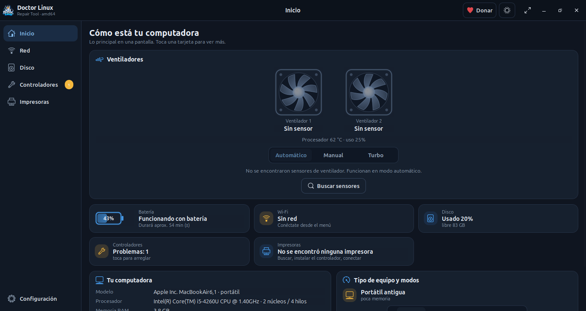

<p align="center">
  
</p>

<h1 align="center">Doctor Linux Repair Tool</h1>

<p align="center">
  Un programa sencillo para reparar rápido tus controladores, revisar el Wi‑Fi, el disco y las impresoras en GNU/Linux.<br>
  <i>A simple app to quickly fix drivers, check Wi‑Fi, disk and printers on GNU/Linux.</i>
</p>

<p align="center">
  <a href="https://github.com/edwards-tech/Doctor-Linux-Repair-Tool/releases"></a>
  
  
  
  
  <a href="https://github.com/edwards-tech/Doctor-Linux-Repair-Tool/stargazers"></a>
</p>

<p align="center">
  
</p>

## Sobre el programa

**Doctor Linux** funciona **solo en Linux**. Está hecho para que cualquier usuario pueda reparar sus
controladores, revisar el Wi‑Fi, comprobar el disco y conectar una impresora de forma **simple y rápida**,
sin terminal y sin buscar en foros. El modo simple es para todos; el modo experto, para quien quiere verlo todo.

Por ahora el programa se publica **solo para sistemas basados en Debian** como paquete **`.deb`** (amd64).
Interfaz en tres idiomas: español, English, русский.

## Qué puede hacer

| | |
|---|---|
| 🔧 **Controladores** | revisa todos los dispositivos, busca e instala los controladores que faltan, repara GRUB y los paquetes |
| 📶 **Wi‑Fi** | señal, velocidad, ping, prueba de velocidad, redes cercanas y consejos sobre qué hacer |
| 🖨️ **Impresoras y escáneres** | detección automática por USB y Wi‑Fi, búsqueda del controlador por modelo, instalación y eliminación, impresión sin controlador, escáneres |
| 💽 **Disco duro** | espacio usado, limpieza, borrado selectivo, recuperación de archivos, SMART |
| 🖥️ **Características completas de la computadora** | procesador, memoria, video, batería, ventiladores, temperatura |

## Compatibilidad

Cualquier distribución basada en Debian / Ubuntu:

<p>
  
  
  
  
  
  
  
  
  
  
  
</p>

## Instalación

Descarga el `.deb` desde [Releases](https://github.com/edwards-tech/Doctor-Linux-Repair-Tool/releases) e instálalo:

```bash
sudo apt install ./doctor-linux-repair-tool_2.4.0_amd64.deb
```

Para desinstalar:

```bash
sudo apt remove doctor-linux-repair-tool
```

## Apoya el proyecto

Si el programa te ayudó, deja una ⭐ **estrella** en el repositorio o apoya al autor con una donación en cripto:

**USDT (TRC‑20):** `TN5JmBVuutG48BcmfLqqB17Cf5YDdz1bw3`

## Contacto

- Telegram: [@edwards_lab](https://t.me/edwards_lab)
- Errores, fallos e ideas: decoder283@proton.me

## Autor y licencia

**Autor del programa: Eduard Nagaev.** Licencia **MIT**.

Si modificas el programa o creas otro basado en él, debes conservar el nombre del autor y el texto de la
licencia MIT. El programa está en fase **beta**: úsalo bajo tu propio riesgo.

<p align="center"><sub>Hecho con ayuda de inteligencia artificial · Made with the help of AI</sub></p>
